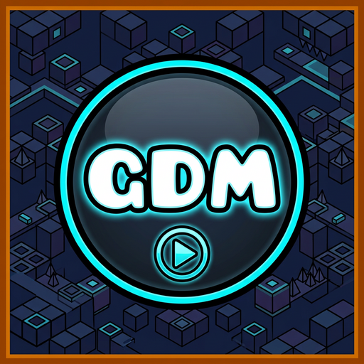

# GDMenu
Geode mod for GD 2.2081 (Geode v5): a bot (.gdbot files), resume where you left off, frame stepper, noclip, speedhack, hitboxes, custom click sounds, hardest-level screenshots, warm-up mode, themes and more.

## How to use
Nothing is shown while you play. **Pause** and tap the floating **GDMenu** button. You can drag it anywhere, and it remembers where you put it.

| Tab | What's inside |
|---|---|
| **Bot** | Status, Record / Play / Save Bot, **Auto-save on complete**, and **Resume session** (continue where you left off) |
| **Bots** | Every `.gdbot` in `save/geode/mods/cyber39dreamgd.gdmenu/replays` - Load / **Play** / **GO** (jumps to the level and auto-plays the bot) / Delete / Open Folder, level stars, and a **saved sessions** list |
| **Hacks** | Noclip, Show Hitboxes, **Auto-Checkpoint**, **Warm-Up Mode**, Speedhack (with speed controls) |
| **Tools** | Frame Stepper, **In-game Status** indicator, **Practice in the editor**, Start Pos Switcher |
| **More** | Autoclicker, Safe Mode, Noclip Accuracy, **Settings export / import** |
| **Style** | 11 themes, **custom accent colour**, bubble opacity/size, **custom click sound**, preset profiles |
| **Keys** | PC keybinds (incl. the **Panic key**), Settings, Reset Button Position |
| **Hardest** | Set the level you're conquering; on a clean win GDMenu saves a screenshot to `newhardestpictures` |

## Bot files
- `.gdbot` uses **GDMenu's own binary format** ("GDMR") - the mod no longer creates GDR2 files. Bots made with v2.7.0 or earlier (GDR2 layout) still load.
- Frames use `m_currentProgress` (240 ticks per second), and player-2 inputs are only saved in 2-player levels.
- If you quit while recording, the session is saved. Next time, open **Bot > Resume**: the bot fast-forwards to where you left off, freezes on that frame, and keeps recording.
- **Auto-play:** press **Play** (or **GO**) before you enter a level - the bot is armed (you'll see `ARMED` under the tabs) and starts by itself the moment you enter that level.

## Mobile & PC
- **PC:** hidden keybinds for every hack, plus a **panic key** (default **P**) that switches all hacks off with one press. Change them in Settings. The floating bubble is replaced by a **menu key** (default: left or right **Control**) that opens/closes the GDMenu panel - change it in Settings, or leave it empty to get the bubble back.
- **Attempt cap** (Settings): after **Attempt Cap** tries in one level, GDMenu asks you to take a break for **Break Time** minutes (default 10) (a `BRK` tag shows in the in-game status while it runs).
- **Mobile:** larger buttons. While the frame stepper is on, small **+1 / +10 / Play** buttons appear so you can step with touch.
- **During gameplay** the only things that can be visible are the optional **In-game Status** indicator (top-right) and the **Noclip Accuracy** counter (top-left) - both off-able, both small.

## Sharing
- **Settings as a code**: More tab > **Copy Code** / **Export to File** captures your whole setup (settings + saved values). **Import Settings** restores one.
- **Custom click sounds**: drop `.mp3` / `.wav` / `.ogg` files into `save/geode/mods/cyber39dreamgd.gdmenu/clicksounds`, then pick one in Style > Click Sound. Only your own jump clicks play it - the bot and the autoclicker stay silent.

## Credits
Special thanks to **prevxGD** for infinitely upgrading the mod.

## Build
Pushes are built automatically by GitHub Actions (download **Build Output**). To build locally: `geode build`.
